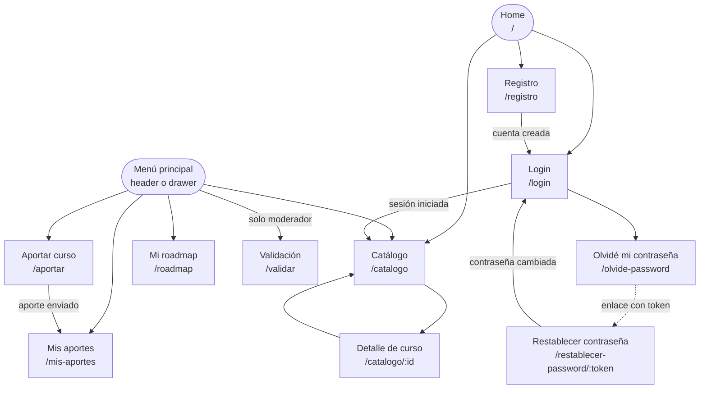

# APPFlow — Mapa del sitio y flujos de usuario — AprovechaElBug

> **Qué es:** el esqueleto de navegación: sitemap, rutas, ficha por pantalla y flujos de
> punta a punta. Une el [PRD](PRD.md) (qué quiere el usuario) con el
> [BackendSchema](BackendSchema.md) (qué API lo sostiene). Los componentes visuales están
> en [UX-UI](UX-UI.md).

## 1. Sitemap

## 2. Rutas

| Ruta | Pantalla | Requiere login | Notas |
|------|----------|----------------|-------|
| `/` | Home | no | presenta la propuesta y lleva al catálogo; no consume API |
| `/catalogo` | Catálogo comunitario (paginado) | no | estado en la URL: `?q=`, `?categoria=`, `?page=` |
| `/catalogo/:id` | Detalle de curso | no | solo cursos publicados |
| `/registro` | Registro | no | si ya hay sesión, redirige a `/catalogo` |
| `/login` | Login | no | acepta `?volver=<ruta>` para regresar tras entrar |
| `/olvide-password` | Solicitud de recuperación | no | |
| `/restablecer-password/:token` | Nueva contraseña | no | el token viaja en la ruta |
| `/aportar` | Formulario de aporte | sí | |
| `/mis-aportes` | Estado de mis aportes (paginado) | sí | |
| `/validar` | Panel de validación (paginado) | sí, rol moderador | otro rol ve la pantalla "No tenés permiso" |
| `/roadmap` | Mi roadmap (paginado) | sí | redirige a `/login?volver=/roadmap` si no hay sesión |
| `*` | Página no encontrada | no | cualquier ruta inexistente |

## 3. Fichas de pantalla

> Todas las pantallas consumen además `GET /api/v1/auth/me` al cargar la app, para conocer
> la sesión y el rol del header.

### Pantalla: Home (`/`)

- **Objetivo del usuario:** entender qué es AprovechaElBug y entrar al catálogo.
- **Componentes (UX-UI):** header, título, dos botones (primario "Explorar catálogo", secundario "Aportar un curso") y tres pasos de "cómo funciona".
- **Estados:** `ok` (pantalla estática).
- **APIs que consume:** ninguna.
- **Navegación:** hacia `/catalogo`, `/aportar` (con login) y `/registro`.

### Pantalla: Catálogo comunitario (`/catalogo`)

- **Objetivo del usuario:** descubrir cursos publicados, buscarlos y agregarlos a su roadmap. Historias: US-001, US-007, US-006.
- **Componentes (UX-UI):** header, campo de búsqueda, select de categoría, grid de cards (§4.4), paginador, toast, skeleton, estado vacío.
- **Estados:** `loading` (skeleton) · `ok` · `vacío` (sin resultados, con "Limpiar filtros") · `error` (con "Reintentar").
- **APIs que consume:** `GET /api/v1/cursos?page=&page_size=&categoria=&q=` · `GET /api/v1/categorias` (opciones del filtro) · `POST /api/v1/roadmap/items` (botón "Agregar a mi roadmap").
- **Navegación:** al detalle del curso; el botón "Agregar" sin sesión lleva a `/login?volver=/catalogo`.

### Pantalla: Detalle de curso (`/catalogo/:id`)

- **Objetivo del usuario:** ver todos los datos de un curso y decidir si lo agrega o lo toma. Historias: US-001, US-006.
- **Componentes (UX-UI):** header, datos del curso, badges, botón "Ir al curso" (enlace externo con `rel="noopener noreferrer"`), botón "Agregar a mi roadmap".
- **Estados:** `loading` · `ok` · `no encontrado` (curso inexistente o no publicado) · `error`.
- **APIs que consume:** `GET /api/v1/cursos/{id}` · `POST /api/v1/roadmap/items`.
- **Navegación:** vuelve al catálogo conservando los filtros.

### Pantalla: Registro (`/registro`)

- **Objetivo del usuario:** crear una cuenta. Historia: US-002.
- **Componentes (UX-UI):** campos nombre, email, contraseña y repetir contraseña (esta última se compara solo en el frontend), botón primario, enlace a login.
- **Estados:** `default` · `error de campo` · `enviando` · éxito (redirige a `/login` con toast).
- **APIs que consume:** `POST /api/v1/auth/registro`.
- **Navegación:** hacia `/login`.

### Pantalla: Login (`/login`)

- **Objetivo del usuario:** iniciar sesión. Historia: US-003.
- **Componentes (UX-UI):** campos email y contraseña, botón primario, enlaces a registro y a "Olvidé mi contraseña".
- **Estados:** `default` · `error` (mensaje genérico) · `bloqueado` (mensaje con el tiempo de espera, tomado de `retry_after_seconds`) · `enviando`.
- **APIs que consume:** `POST /api/v1/auth/login`.
- **Navegación:** a la ruta de `?volver=` o, si no hay, a `/catalogo`.

### Pantalla: Olvidé mi contraseña (`/olvide-password`)

- **Objetivo del usuario:** pedir el enlace de recuperación. Historia: US-008.
- **Componentes (UX-UI):** campo email, botón primario, mensaje de confirmación.
- **Estados:** `default` · `enviando` · `confirmación` (mismo mensaje exista o no la cuenta, BR-008).
- **APIs que consume:** `POST /api/v1/auth/recuperar`.
- **Navegación:** vuelve a `/login`.

### Pantalla: Restablecer contraseña (`/restablecer-password/:token`)

- **Objetivo del usuario:** definir una nueva contraseña con el enlace recibido. Historia: US-008.
- **Componentes (UX-UI):** campos nueva contraseña y repetirla, botón primario.
- **Estados:** `default` · `error de campo` · `token inválido o vencido` (mensaje y enlace a `/olvide-password`) · éxito (redirige a `/login` con toast).
- **APIs que consume:** `POST /api/v1/auth/restablecer`.
- **Navegación:** hacia `/login`.

### Pantalla: Aportar curso (`/aportar`)

- **Objetivo del usuario:** cargar un curso gratuito al catálogo. Historia: US-004.
- **Componentes (UX-UI):** formulario de aporte (§4.3), select de categoría, casillas, grupo de radios "¿Tomaste este curso?", toast.
- **Estados:** `loading` (carga de categorías) · `default` · `error de campo` · `enviando` · `error de red` (toast y los datos se conservan).
- **APIs que consume:** `GET /api/v1/categorias` · `POST /api/v1/aportes`.
- **Navegación:** al enviar con éxito, a `/mis-aportes` con toast.

### Pantalla: Mis aportes (`/mis-aportes`)

- **Objetivo del usuario:** saber si sus aportes fueron aprobados o rechazados y por qué. Historia: US-009.
- **Componentes (UX-UI):** tabla o cards (§4.6), badge de estado (§4.5), paginador.
- **Estados:** `loading` · `ok` · `vacío` (con botón "Aportar el primero") · `error`.
- **APIs que consume:** `GET /api/v1/aportes/mios?page=&page_size=`.
- **Navegación:** hacia `/aportar`; los aportes publicados enlazan a su detalle.

### Pantalla: Validación (`/validar`)

- **Objetivo del usuario (moderador):** revisar aportes pendientes y aprobarlos o rechazarlos. Historia: US-005.
- **Componentes (UX-UI):** tabla o cards con todos los datos del aporte, botones "Aprobar" y "Rechazar", modal de rechazo con motivo obligatorio (§4.9), paginador, toast.
- **Estados:** `loading` · `ok` · `vacío` ("No hay aportes pendientes") · `error` · `sin permiso` (usuario sin rol moderador).
- **APIs que consume:** `GET /api/v1/aportes/pendientes?page=&page_size=` · `POST /api/v1/aportes/{id}/validar`.
- **Navegación:** solo desde el menú, visible solo para el moderador.

### Pantalla: Mi roadmap (`/roadmap`)

- **Objetivo del usuario:** ver y mantener su plan de aprendizaje. Historias: US-006, US-010.
- **Componentes (UX-UI):** tabla o cards, select de estado de avance, botones Subir y Bajar, botón Quitar con modal de confirmación (§4.12), paginador.
- **Estados:** `loading` · `ok` · `vacío` (con acceso al catálogo) · `error`.
- **APIs que consume:** `GET /api/v1/roadmap?page=&page_size=` · `PATCH /api/v1/roadmap/items/{id}` · `POST /api/v1/roadmap/items/{id}/mover` · `DELETE /api/v1/roadmap/items/{id}`.
- **Navegación:** hacia el catálogo y hacia el detalle de cada curso.