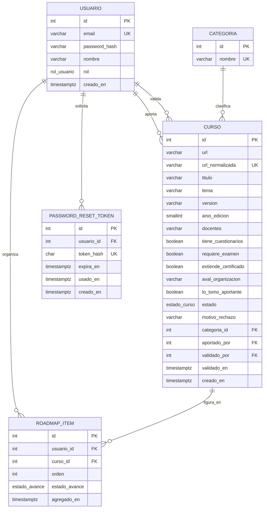
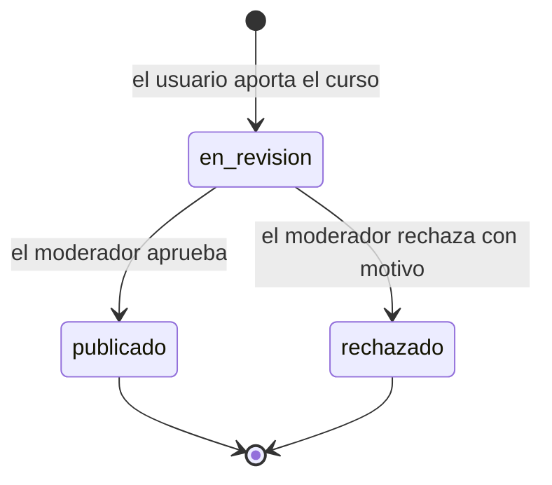

# BackendSchema — Esquema de base de datos y APIs — AprovechaElBug

> **Qué es:** el contrato del backend: modelo de datos en PostgreSQL 18.6 y superficie de
> la API REST. Lo consume el [APPFlow](APPFlow.md) y lo implementa el [TRD](TRD.md).

## 1. Modelo de datos

### 1.1 Diagrama entidad-relación

### 1.2 Tablas

Los identificadores son enteros autogenerados (`GENERATED ALWAYS AS IDENTITY`). Todos los timestamps son `timestamptz` en UTC.

#### `usuarios`

| Columna | Tipo | Constraints | Notas |
|---------|------|-------------|-------|
| id | int identity | PK | |
| email | varchar(254) | NOT NULL | identificador de login; índice único sobre `lower(email)` (BR-011) |
| password_hash | varchar(100) | NOT NULL | hash bcrypt (costo 12); nunca la contraseña en claro |
| nombre | varchar(100) | NOT NULL | |
| rol | enum `rol_usuario` | NOT NULL, default `usuario` | valores: `usuario`, `moderador` |
| creado_en | timestamptz | NOT NULL, default `now()` | |

**Índices:** único `lower(email)`: acelera el login y garantiza la unicidad sin distinguir mayúsculas.

#### `categorias`

| Columna | Tipo | Constraints | Notas |
|---------|------|-------------|-------|
| id | int identity | PK | |
| nombre | varchar(80) | NOT NULL, UNIQUE | lista cerrada cargada por seed (TRD TD-007) |

#### `cursos`

Esta tabla guarda tanto el aporte como el curso: un aporte es un curso en estado `en_revision` (decisión de SPEC §8, vacío 6).

| Columna | Tipo | Constraints | Notas |
|---------|------|-------------|-------|
| id | int identity | PK | |
| url | varchar(2048) | NOT NULL | enlace tal como lo ingresó quien aporta |
| url_normalizada | varchar(2048) | NOT NULL, UNIQUE | clave de duplicados (BR-004) |
| titulo | varchar(200) | NOT NULL | |
| tema | varchar(120) | NOT NULL | |
| version | varchar(50) | NOT NULL | |
| anio_edicion | smallint | NOT NULL, CHECK entre 1990 y 2100 | |
| docentes | varchar(300) | NOT NULL | docentes o disertantes |
| tiene_cuestionarios | boolean | NOT NULL | |
| requiere_examen | boolean | NOT NULL | |
| extiende_certificado | boolean | NOT NULL | |
| aval_organizacion | varchar(150) | NULL | organización que lo avala, si la hay |
| lo_tomo_aportante | boolean | NOT NULL | BR-002 |
| estado | enum `estado_curso` | NOT NULL, default `en_revision` | ver §2 |
| motivo_rechazo | varchar(500) | NULL | obligatorio si el estado es `rechazado` |
| categoria_id | int | NOT NULL, FK → `categorias` | |
| aportado_por | int | NOT NULL, FK → `usuarios` | |
| validado_por | int | NULL, FK → `usuarios` | quien decidió |
| validado_en | timestamptz | NULL | |
| creado_en | timestamptz | NOT NULL, default `now()` | |

**Constraints de coherencia:**
- `CHECK (estado <> 'rechazado' OR motivo_rechazo IS NOT NULL)` (BR-005).
- `CHECK (estado = 'en_revision' OR (validado_por IS NOT NULL AND validado_en IS NOT NULL))`.

**Índices:**
- único sobre `url_normalizada` (BR-004).
- `(creado_en DESC)` parcial `WHERE estado = 'publicado'`: listado del catálogo.
- `(categoria_id, creado_en DESC)` parcial `WHERE estado = 'publicado'`: filtro por categoría.
- `(creado_en)` parcial `WHERE estado = 'en_revision'`: panel de validación, los más antiguos primero.
- `(aportado_por, creado_en DESC)`: mis aportes.

La búsqueda por texto usa `ILIKE` sobre `titulo` y `tema`; con el volumen del MVP (1.000 cursos, RNF-007) no necesita un índice específico.

#### `roadmap_items`

| Columna | Tipo | Constraints | Notas |
|---------|------|-------------|-------|
| id | int identity | PK | |
| usuario_id | int | NOT NULL, FK → `usuarios`, ON DELETE CASCADE | |
| curso_id | int | NOT NULL, FK → `cursos` | |
| orden | int | NOT NULL | posición dentro del roadmap del usuario; puede tener huecos |
| estado_avance | enum `estado_avance` | NOT NULL, default `pendiente` | valores: `pendiente`, `en_curso`, `completado` |
| agregado_en | timestamptz | NOT NULL, default `now()` | |

**Constraints:** `UNIQUE (usuario_id, curso_id)` (BR-007).
**Índices:** `(usuario_id, orden)`: listado ordenado del roadmap.
> Que el curso esté publicado (BR-006) lo verifica el service antes de insertar; no se expresa como constraint porque cruza dos tablas.

#### `password_reset_tokens`

| Columna | Tipo | Constraints | Notas |
|---------|------|-------------|-------|
| id | int identity | PK | |
| usuario_id | int | NOT NULL, FK → `usuarios`, ON DELETE CASCADE | |
| token_hash | char(64) | NOT NULL, UNIQUE | SHA-256 del token (TRD TD-006) |
| expira_en | timestamptz | NOT NULL | creación + 1 hora (BR-008) |
| usado_en | timestamptz | NULL | marca de uso único |
| creado_en | timestamptz | NOT NULL, default `now()` | |

**Índices:** `(usuario_id)`. Al emitir un token nuevo se marcan como usados los anteriores pendientes del mismo usuario.

## 2. Estados del ciclo de vida del curso

| Estado | Quién lo ve | Qué puede pasar |
|--------|-------------|-----------------|
| `en_revision` | su autor y los moderadores | el moderador lo aprueba o lo rechaza |
| `publicado` | todos (catálogo y detalle) | se incluye en roadmaps |
| `rechazado` | su autor (con el motivo) y los moderadores | nada: es definitivo; para insistir se aporta uno nuevo |

`publicado` y `rechazado` son estados finales: una decisión ya tomada no se modifica (la API responde 409).