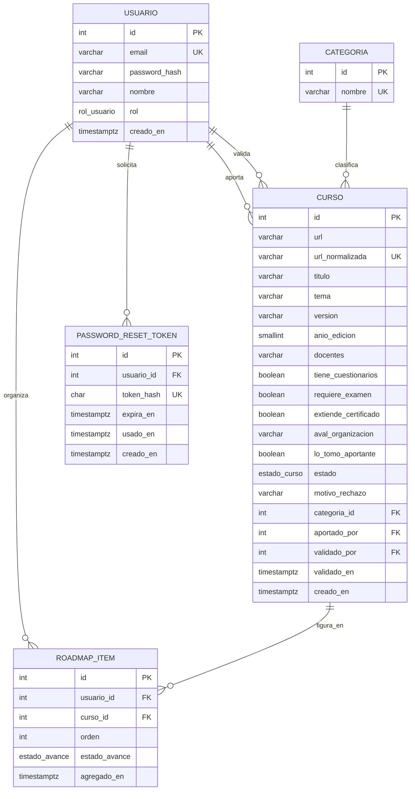
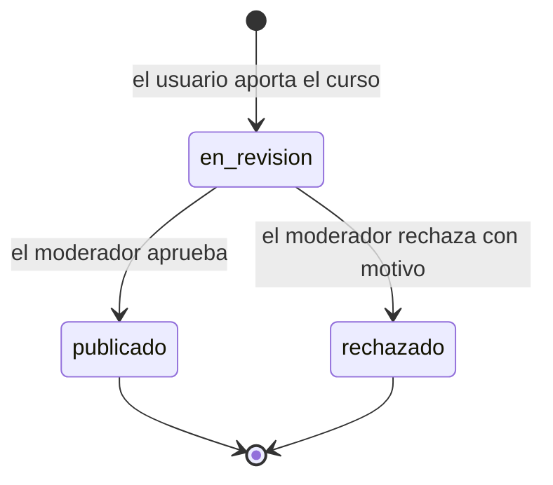

# BackendSchema — Esquema de base de datos y APIs — AprovechaElBug

> **Qué es:** el contrato del backend: modelo de datos en PostgreSQL 18.6 y superficie de
> la API REST. Lo consume el [APPFlow](APPFlow.md) y lo implementa el [TRD](TRD.md).

## 1. Modelo de datos

### 1.1 Diagrama entidad-relación



### 1.2 Tablas

Los identificadores son enteros autogenerados (`GENERATED ALWAYS AS IDENTITY`). Todos los timestamps son `timestamptz` en UTC.

#### `usuarios`

| Columna | Tipo | Constraints | Notas |
|---------|------|-------------|-------|
| id | int identity | PK | |
| email | varchar(254) | NOT NULL | identificador de login; índice único sobre `lower(email)` (BR-011) |
| password_hash | varchar(100) | NOT NULL | hash bcrypt (costo 12); nunca la contraseña en claro |
| nombre | varchar(100) | NOT NULL | |
| rol | enum `rol_usuario` | NOT NULL, default `usuario` | valores: `usuario`, `moderador` |
| creado_en | timestamptz | NOT NULL, default `now()` | |

**Índices:** único `lower(email)`: acelera el login y garantiza la unicidad sin distinguir mayúsculas.

#### `categorias`

| Columna | Tipo | Constraints | Notas |
|---------|------|-------------|-------|
| id | int identity | PK | |
| nombre | varchar(80) | NOT NULL, UNIQUE | lista cerrada cargada por seed (TRD TD-007) |

#### `cursos`

Esta tabla guarda tanto el aporte como el curso: un aporte es un curso en estado `en_revision` (decisión de SPEC §8, vacío 6).

| Columna | Tipo | Constraints | Notas |
|---------|------|-------------|-------|
| id | int identity | PK | |
| url | varchar(2048) | NOT NULL | enlace tal como lo ingresó quien aporta |
| url_normalizada | varchar(2048) | NOT NULL, UNIQUE | clave de duplicados (BR-004) |
| titulo | varchar(200) | NOT NULL | |
| tema | varchar(120) | NOT NULL | |
| version | varchar(50) | NOT NULL | |
| anio_edicion | smallint | NOT NULL, CHECK entre 1990 y 2100 | |
| docentes | varchar(300) | NOT NULL | docentes o disertantes |
| tiene_cuestionarios | boolean | NOT NULL | |
| requiere_examen | boolean | NOT NULL | |
| extiende_certificado | boolean | NOT NULL | |
| aval_organizacion | varchar(150) | NULL | organización que lo avala, si la hay |
| lo_tomo_aportante | boolean | NOT NULL | BR-002 |
| estado | enum `estado_curso` | NOT NULL, default `en_revision` | ver §2 |
| motivo_rechazo | varchar(500) | NULL | obligatorio si el estado es `rechazado` |
| categoria_id | int | NOT NULL, FK → `categorias` | |
| aportado_por | int | NOT NULL, FK → `usuarios` | |
| validado_por | int | NULL, FK → `usuarios` | quien decidió |
| validado_en | timestamptz | NULL | |
| creado_en | timestamptz | NOT NULL, default `now()` | |

**Constraints de coherencia:**
- `CHECK (estado <> 'rechazado' OR motivo_rechazo IS NOT NULL)` (BR-005).
- `CHECK (estado = 'en_revision' OR (validado_por IS NOT NULL AND validado_en IS NOT NULL))`.

**Índices:**
- único sobre `url_normalizada` (BR-004).
- `(creado_en DESC)` parcial `WHERE estado = 'publicado'`: listado del catálogo.
- `(categoria_id, creado_en DESC)` parcial `WHERE estado = 'publicado'`: filtro por categoría.
- `(creado_en)` parcial `WHERE estado = 'en_revision'`: panel de validación, los más antiguos primero.
- `(aportado_por, creado_en DESC)`: mis aportes.

La búsqueda por texto usa `ILIKE` sobre `titulo` y `tema`; con el volumen del MVP (1.000 cursos, RNF-007) no necesita un índice específico.

#### `roadmap_items`

| Columna | Tipo | Constraints | Notas |
|---------|------|-------------|-------|
| id | int identity | PK | |
| usuario_id | int | NOT NULL, FK → `usuarios`, ON DELETE CASCADE | |
| curso_id | int | NOT NULL, FK → `cursos` | |
| orden | int | NOT NULL | posición dentro del roadmap del usuario; puede tener huecos |
| estado_avance | enum `estado_avance` | NOT NULL, default `pendiente` | valores: `pendiente`, `en_curso`, `completado` |
| agregado_en | timestamptz | NOT NULL, default `now()` | |

**Constraints:** `UNIQUE (usuario_id, curso_id)` (BR-007).
**Índices:** `(usuario_id, orden)`: listado ordenado del roadmap.
> Que el curso esté publicado (BR-006) lo verifica el service antes de insertar; no se expresa como constraint porque cruza dos tablas.

#### `password_reset_tokens`

| Columna | Tipo | Constraints | Notas |
|---------|------|-------------|-------|
| id | int identity | PK | |
| usuario_id | int | NOT NULL, FK → `usuarios`, ON DELETE CASCADE | |
| token_hash | char(64) | NOT NULL, UNIQUE | SHA-256 del token (TRD TD-006) |
| expira_en | timestamptz | NOT NULL | creación + 1 hora (BR-008) |
| usado_en | timestamptz | NULL | marca de uso único |
| creado_en | timestamptz | NOT NULL, default `now()` | |

**Índices:** `(usuario_id)`. Al emitir un token nuevo se marcan como usados los anteriores pendientes del mismo usuario.

## 2. Estados del ciclo de vida del curso



| Estado | Quién lo ve | Qué puede pasar |
|--------|-------------|-----------------|
| `en_revision` | su autor y los moderadores | el moderador lo aprueba o lo rechaza |
| `publicado` | todos (catálogo y detalle) | se incluye en roadmaps |
| `rechazado` | su autor (con el motivo) y los moderadores | nada: es definitivo; para insistir se aporta uno nuevo |

`publicado` y `rechazado` son estados finales: una decisión ya tomada no se modifica (la API responde 409).


## 3. API REST

**Convenciones generales:**

- Prefijo: `/api/v1`.
- **Sesión:** cookie `aeb_session` (HttpOnly, SameSite=Lax) emitida por el login (TRD TD-001). "Sesión" en las tablas significa usuario autenticado y "moderador" significa usuario autenticado con ese rol.
- **Paginación** (TRD TD-002): `?page=1&page_size=20` (`page` desde 1; `page_size` por defecto 20, máximo 50). Respuesta:
  `{ "items": [...], "total": N, "page": n, "page_size": n }`.
- **Errores:** formato y códigos definidos en [TRD §4](TRD.md). Un error 429 agrega `retry_after_seconds` dentro de `error` y el encabezado `Retry-After`.
- Timestamps en ISO 8601 UTC. Los nombres de estados son los del §1 y §2, idénticos en todas las respuestas.
- **Excepción documentada a la paginación:** `GET /categorias` devuelve la lista cerrada completa (pocas decenas de elementos) porque solo alimenta un select; no es un listado ni una tabla de pantalla.

### 3.1 Autenticación

| Método | Path | Auth | Request | Respuestas |
|--------|------|------|---------|------------|
| POST | `/api/v1/auth/registro` | pública | `{ "nombre", "email", "password" }` (contraseña de 8 a 72 caracteres) | 201 `{ "usuario": {…} }` · 409 email duplicado · 422 |
| POST | `/api/v1/auth/login` | pública | `{ "email", "password" }` | 200 `{ "usuario": {…} }` y cookie de sesión · 401 credenciales inválidas · 422 · 429 bloqueado |
| POST | `/api/v1/auth/logout` | sesión | — | 204 y cookie eliminada · 401 |
| GET | `/api/v1/auth/me` | pública | — | 200 `{ "usuario": {…} }` si hay sesión; 200 `{ "usuario": null }` si no |
| POST | `/api/v1/auth/recuperar` | pública | `{ "email" }` | 202 siempre con el mismo cuerpo, exista o no la cuenta · 422 |
| POST | `/api/v1/auth/restablecer` | pública | `{ "token", "password" }` | 204 · 422 (contraseña inválida, o token inexistente, vencido o usado) |

Objeto `usuario`: `{ "id": 1, "nombre": "Lucía", "email": "lucia@ejemplo.com", "rol": "usuario" }`.

Ejemplo `POST /api/v1/auth/login` con demasiados intentos → 429:

```json
{
  "error": {
    "code": "RATE_LIMITED",
    "message": "Demasiados intentos. Probá de nuevo más tarde.",
    "retry_after_seconds": 540
  }
}
```

### 3.2 Catálogo de cursos

| Método | Path | Auth | Query / Request | Respuestas |
|--------|------|------|-----------------|------------|
| GET | `/api/v1/cursos` | pública | `page`, `page_size`, `categoria` (id), `q` (texto sobre título y tema) | 200 paginado, solo cursos publicados, más recientes primero · 422 |
| GET | `/api/v1/cursos/{id}` | pública | — | 200 · 404 (inexistente o no publicado) |

El campo `en_mi_roadmap` es `true` solo si hay sesión y el curso ya está en su roadmap; sin sesión siempre es `false`.

Ejemplo `GET /api/v1/cursos?page=1&page_size=2&categoria=3&q=python` → 200:

```json
{
  "items": [
    {
      "id": 12,
      "url": "https://www.ejemplo.com/cursos/python-desde-cero",
      "titulo": "Python desde cero",
      "tema": "Programación",
      "version": "2024",
      "anio_edicion": 2024,
      "docentes": "Ana Pérez, Luis Gómez",
      "categoria": { "id": 3, "nombre": "Programación" },
      "tiene_cuestionarios": true,
      "requiere_examen": false,
      "extiende_certificado": true,
      "aval_organizacion": null,
      "lo_tomo_aportante": true,
      "estado": "publicado",
      "en_mi_roadmap": false
    }
  ],
  "total": 47,
  "page": 1,
  "page_size": 2
}
```

### 3.3 Aportes de cursos y validación

| Método | Path | Auth | Request | Respuestas |
|--------|------|------|---------|------------|
| POST | `/api/v1/aportes` | sesión | campos del aporte (abajo) | 201 con el curso en `en_revision` · 401 · 409 enlace duplicado · 422 |
| GET | `/api/v1/aportes/mios` | sesión | `page`, `page_size` | 200 paginado, solo los aportes propios, con `estado` y `motivo_rechazo` · 401 |
| GET | `/api/v1/aportes/pendientes` | moderador | `page`, `page_size` | 200 paginado, aportes en `en_revision`, más antiguos primero · 401 · 403 |
| POST | `/api/v1/aportes/{id}/validar` | moderador | `{ "aprobado": true }` o `{ "aprobado": false, "motivo": "…" }` | 200 con el curso actualizado · 401 · 403 · 404 · 409 ya decidido · 422 (rechazo sin motivo) |

Campos de `POST /api/v1/aportes`:

| Campo | Regla |
|-------|-------|
| `url` | obligatorio; `http` o `https`; hasta 2048 caracteres |
| `categoria_id` | obligatorio; debe existir |
| `titulo` | obligatorio; hasta 200 caracteres |
| `tema` | obligatorio; hasta 120 caracteres |
| `version` | obligatorio; hasta 50 caracteres |
| `anio_edicion` | obligatorio; entero entre 1990 y el año en curso (BR-012) |
| `docentes` | obligatorio; hasta 300 caracteres |
| `tiene_cuestionarios`, `requiere_examen`, `extiende_certificado` | obligatorios; booleanos |
| `aval_organizacion` | opcional; hasta 150 caracteres |
| `lo_tomo_aportante` | obligatorio; booleano, sin valor por defecto (BR-002) |

Ejemplo de request:

```json
{
  "url": "https://www.ejemplo.com/cursos/python-desde-cero",
  "categoria_id": 3,
  "tema": "Programación",
  "titulo": "Python desde cero",
  "version": "2024",
  "anio_edicion": 2024,
  "docentes": "Ana Pérez, Luis Gómez",
  "tiene_cuestionarios": true,
  "requiere_examen": false,
  "extiende_certificado": true,
  "aval_organizacion": null,
  "lo_tomo_aportante": true
}
```

La respuesta 201 devuelve el mismo objeto de curso del §3.2 con `"estado": "en_revision"`.

### 3.4 Roadmap del usuario

| Método | Path | Auth | Request | Respuestas |
|--------|------|------|---------|------------|
| GET | `/api/v1/roadmap` | sesión | `page`, `page_size` | 200 paginado, ordenado por `orden`; cada ítem trae su curso · 401 |
| POST | `/api/v1/roadmap/items` | sesión | `{ "curso_id": 12 }` (la posición se asigna al final) | 201 con el ítem · 401 · 404 (curso inexistente o no publicado) · 409 ya incluido |
| PATCH | `/api/v1/roadmap/items/{id}` | sesión | `{ "estado_avance": "en_curso" }` | 200 con el ítem · 401 · 404 · 422 |
| POST | `/api/v1/roadmap/items/{id}/mover` | sesión | `{ "direccion": "subir" }` o `{ "direccion": "bajar" }` | 200 con el ítem (si ya está en el extremo no cambia nada) · 401 · 404 · 422 |
| DELETE | `/api/v1/roadmap/items/{id}` | sesión | — | 204 · 401 · 404 |

Un ítem de otro usuario responde 404, no 403, para no revelar que existe (BR-003).

Ejemplo de ítem:

```json
{
  "id": 5,
  "orden": 2,
  "estado_avance": "pendiente",
  "agregado_en": "2026-10-23T18:30:00Z",
  "curso": { "id": 12, "titulo": "Python desde cero", "…": "…" }
}
```

### 3.5 Categorías (lista cerrada)

| Método | Path | Auth | Respuestas |
|--------|------|------|------------|
| GET | `/api/v1/categorias` | pública | 200 `{ "items": [ { "id": 3, "nombre": "Programación" } ] }`, ordenadas por nombre |

## 4. Decisiones del esquema

| Decisión | Alternativas | Por qué |
|----------|--------------|---------|
| Aporte y curso en una sola tabla con `estado` | tabla `aportes` aparte que genera filas de `cursos` al aprobar | un curso rechazado o en revisión sigue siendo el mismo registro; evita duplicar datos y mantiene la unicidad del enlace en un solo lugar |
| Categorías en una tabla con FK | enum de PostgreSQL | agregar una categoría es un dato (seed), no una migración de tipo |
| Roadmap como tabla `roadmap_items` con `orden` y `estado_avance` | lista dentro del usuario; varias tablas de roadmaps | cubre BR-003 y BR-007 con constraints; un roadmap por usuario alcanza (TRD TD-004) |
| `orden` sin restricción de unicidad | `UNIQUE (usuario_id, orden)` | mover un ítem intercambia posiciones con su vecino sin tener que diferir constraints; los huecos tras borrar no afectan el orden |
| Columna `url_normalizada` única | comparar `url` con función en cada consulta; índice sobre expresión | la normalización se calcula una vez en el service (función pura y testeable) y la base garantiza BR-004 aunque haya concurrencia |
| Banderas del curso como tres booleanos | `jsonb` con características | son tres preguntas fijas de la SPEC; los booleanos se filtran y validan con tipos |
| Se guarda solo el hash del token de recuperación | guardar el token | una filtración de la base no entrega tokens utilizables |
| Identificadores enteros autogenerados | UUID | volumen chico, URLs más simples y menor tamaño de índices |

## 5. Trazabilidad

### 5.1 Requisito funcional → endpoint

| RF | Endpoint |
|----|----------|
| RF-001 | `POST /auth/registro` |
| RF-002 | `POST /auth/login` y `GET /auth/me` |
| RF-003 | `POST /auth/logout` |
| RF-004 | `POST /auth/login` (respuesta 429) |
| RF-005 | `POST /auth/recuperar` |
| RF-006 | `POST /auth/restablecer` |
| RF-007 | `GET /cursos` |
| RF-008 | `GET /cursos/{id}` |
| RF-009 | `GET /cursos` con `q` y `categoria` |
| RF-010 | `GET /categorias` |
| RF-011 | `POST /aportes` |
| RF-012 | `POST /aportes` (respuesta 409) |
| RF-013 | `GET /aportes/mios` |
| RF-014 | `GET /aportes/pendientes` |
| RF-015 | `POST /aportes/{id}/validar` |
| RF-016 | `POST /roadmap/items` |
| RF-017 | `GET /roadmap` |
| RF-018 | `PATCH /roadmap/items/{id}` y `POST /roadmap/items/{id}/mover` |
| RF-019 | `DELETE /roadmap/items/{id}` |
| RF-020 | rol y sesión verificados en todos los endpoints marcados "sesión" o "moderador" |

### 5.2 Regla de negocio → dónde se hace cumplir

| BR | Cumplimiento |
|----|--------------|
| BR-001 | `estado` por defecto `en_revision`; `GET /cursos` y el detalle filtran por `publicado` |
| BR-002 | `lo_tomo_aportante` NOT NULL y obligatorio en el request |
| BR-003 | las consultas del roadmap filtran siempre por el usuario de la sesión; un ítem ajeno responde 404 |
| BR-004 | `url_normalizada` UNIQUE y respuesta 409; normalización en el service: host en minúsculas, sin fragmento, sin barra final, sin parámetros `utm_*` |
| BR-005 | verificación de rol en el service y `CHECK` sobre `motivo_rechazo` |
| BR-006 | el service verifica el estado `publicado` antes de insertar; respuesta 404 si no |
| BR-007 | `UNIQUE (usuario_id, curso_id)` y respuesta 409 |
| BR-008 | `password_reset_tokens` (hash, vencimiento y uso) y respuesta 202 uniforme |
| BR-009 | rate limiting en memoria del service de identidad (TD-005) y respuesta 429 |
| BR-010 | bcrypt costo 12; contraseña de 8 a 72 caracteres (72 es el límite de bcrypt) |
| BR-011 | índice único sobre `lower(email)` y respuesta 409 |
| BR-012 | regla en el service (`validar_datos_aporte`, con el año actual inyectado); el `CHECK` de la base (1990–2100) queda como red de seguridad, porque un `CHECK` de PostgreSQL no puede depender de la fecha actual |

---

**Referencias:**
- Mermaid — Entity Relationship Diagrams: https://mermaid.js.org/syntax/entityRelationshipDiagram.html
- PostgreSQL — The Conceptual Model: https://www.postgresql.org/docs/current/datamodel.html