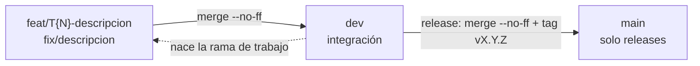

# Flujo de Git — AprovechaElBug

> **Historial del flujo:** durante la Instancia A (hasta el 23/10/2026) se usó GitHub Flow,
> con ramas `docs/*` mergeadas a `main`. Desde el 27/10/2026, por indicación de la cátedra
> (tickets pre-clase), el proyecto usa una rama de integración `dev` y releases versionadas
> en `main`. Este documento describe el flujo vigente.

## 1. Modelo: rama de integración y releases versionadas

- `main` contiene **solo releases**: cada uno con su tag anotado `vX.Y.Z` y su entrada en `CHANGELOG.md`.
- `dev` es la rama de integración: todo lo que entra a un release pasa primero por acá.
- Las ramas de trabajo (`feat/*`, `fix/*`) nacen de `dev` y vuelven a `dev`.

**Por qué:** separa lo integrado (`dev`) de lo publicado (`main`), y cada versión publicada
queda identificada con un tag y descrita en el changelog. Así cualquiera puede volver a una
versión exacta y saber qué cambió entre una y otra.



## 2. Ramas

| Rama | Nace desde | Contiene | Se mergea a |
|------|------------|----------|-------------|
| `main` | — (raíz) | solo releases con tag `vX.Y.Z` y `CHANGELOG.md` actualizado | — |
| `dev` | `main` (una sola vez) | integración: todo lo que entra al próximo release | `main`, en cada release |
| `feat/T{N}-descripcion-corta` | `dev` | una feature o un ticket | `dev` |
| `fix/descripcion-corta` | `dev` | una corrección | `dev` |

**Reglas:**

- `main` nunca recibe commits directos ni merges de `feat/*` o `fix/*`; solo recibe `dev` en un release.
- `N` es el número del ticket (por ejemplo `feat/T2-backend-minimo`).
- Nombres en minúsculas (salvo `T{N}`), con palabras separadas por guiones.

## 3. Ciclo de trabajo de un ticket

```bash
git switch dev
git pull
git switch -c feat/T{N}-descripcion-corta
# trabajar y commitear con Conventional Commits (ver §4)
git switch dev
git merge --no-ff feat/T{N}-descripcion-corta -m "chore: merge feat/T{N}-descripcion-corta into dev"
git branch -d feat/T{N}-descripcion-corta
git push origin dev
```

Cada ticket suma su línea en la sección `[Unreleased]` de `CHANGELOG.md` antes del merge.

## 4. Convención de commits

**Conventional Commits** en el 100% de la historia, incluidos los merges:

```
<tipo>: <descripción corta en imperativo>
```

| Tipo | Cuándo |
|------|--------|
| `feat` | funcionalidad nueva |
| `fix` | corrección de un defecto |
| `docs` | documentación |
| `test` | tests |
| `refactor` | cambio interno sin alterar comportamiento |
| `chore` | configuración, mantenimiento, merges y releases |
| `docker` | contenedores y Compose |

**Reglas:** mensaje específico, en inglés, en imperativo, sin punto final y de menos de 72 caracteres.

| Correcto | Incorrecto |
|----------|------------|
| `feat: add minimal fastapi backend with health and cursos endpoint` | `wip` |
| `chore: merge feat/T2-backend-minimo into dev` | `Merge branch 'feat/T2-backend-minimo'` |
| `docs: finalize changelog for v0.1.0` | `docs: cambios` |

## 5. Releases y versionado semántico

Mientras el producto es inestable, las versiones son `v0.y.z`:

| Parte | Cuándo sube | Ejemplo |
|-------|-------------|---------|
| MAJOR (`vX.0.0`) | cambio que rompe compatibilidad (por ejemplo, de la API) | `v1.0.0` |
| MINOR (`v0.X.0`) | features nuevas compatibles | `v0.2.0` |
| PATCH (`v0.y.Z`) | correcciones sin features nuevas | `v0.1.1` |

Procedimiento de un release:

1. En `dev`: pasar lo de `[Unreleased]` a `[vX.Y.Z] - AAAA-MM-DD` en `CHANGELOG.md`, actualizar
   la tabla de ejecución del `IMPLEMENTATION_PLAN.md` y commitear (`docs: finalize changelog for vX.Y.Z`).
2. Mergear `dev` en `main`: `git switch main` y `git merge --no-ff dev -m "chore: release vX.Y.Z"`.
3. Taggear: `git tag -a vX.Y.Z -m "release: <resumen>"`.
4. Publicar: `git push origin main --tags` y `git push origin dev`.

## 6. Revisión antes de cada merge

Trabajo individual: antes de mergear una rama a `dev` hago una autorrevisión.

- `git diff dev..<rama>` revisado completo.
- La app levanta (`docker compose up --build`) y lo del ticket funciona.
- No se versionan secretos (`.env`), dependencias instaladas (`node_modules`, `.venv`) ni builds (`dist`).
- Los lockfiles (`uv.lock`, `pnpm-lock.yaml`) sí se versionan.

## 7. Relación con las instancias

- **Instancia A (documentación):** GitHub Flow con ramas `docs/*` mergeadas a `main` (historia previa al 27/10).
- **Instancia B y clase del 27/10:** este flujo. Cada ticket es una rama `feat/T{N}-…` o `fix/…`;
  al cerrar un conjunto de tickets se publica un release en `main` con su tag.
- **Gestión del cambio:** cada modificación entra como ticket → rama → commit convencional → merge a `dev` → release.