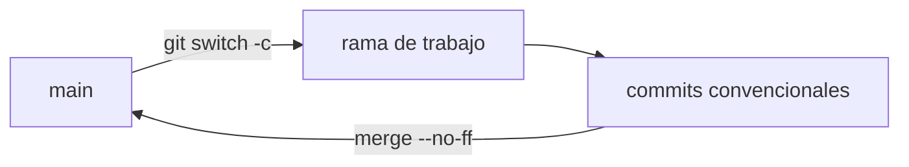

# Flujo de Git — AprovechaElBug

## 1. Modelo elegido: GitHub Flow

- `main` siempre contiene el estado estable y revisado del proyecto.
- Todo cambio nace en una rama corta, sale de `main` y vuelve a `main` mediante un merge.
- No hay ramas de larga vida (`develop`, `release`).

**Por qué GitHub Flow:** el trabajo es individual, los ciclos son cortos (días) y se busca
una historia fácil de leer. Git Flow agrega ramas de integración y de release que no
aportan nada con un solo desarrollador y un solo entorno.



## 2. Ramas

| Rama | Uso | Ejemplo |
|------|-----|---------|
| `main` | estado estable; solo recibe merges | — |
| `docs/<documento>` | un documento o grupo coherente (Instancia A) | `docs/prd` |
| `feat/<modulo>-<tarea>` | una tarea del Implementation Plan (Instancia B) | `feat/m1-login` |
| `fix/<descripcion>` | corrección de un defecto | `fix/paginacion-total` |
| `test/<descripcion>` | tests | `test/roadmap-service` |
| `docker/<descripcion>` | cambios de contenedores | `docker/backend-multistage` |
| `chore/<descripcion>` | configuración y mantenimiento | `chore/repo-setup` |

**Reglas de nombre:** minúsculas, palabras separadas por guiones, prefijo igual al tipo
de commit principal de la rama.

## 3. Ciclo de trabajo (1 rama = 1 documento o 1 tarea)

```bash
git switch main && git pull
git switch -c docs/<nombre>
# trabajar y commitear en pasos pequeños (ver §4)
git push -u origin docs/<nombre>
git switch main
git merge --no-ff docs/<nombre> -m "docs: merge docs/<nombre> branch"
git push origin main
```

## 4. Convención de commits

Se usa **Conventional Commits** en el 100% de la historia, incluidos los merges:

```
<tipo>: <descripción corta en imperativo>
```

| Tipo | Cuándo |
|------|--------|
| `feat` | funcionalidad nueva |
| `fix` | corrección de un defecto |
| `docs` | documentación |
| `test` | tests |
| `refactor` | cambio interno sin alterar comportamiento |
| `chore` | configuración, mantenimiento |
| `docker` | contenedores y Compose |

**Reglas:** mensaje específico, en inglés, en imperativo, sin punto final y de menos de
72 caracteres.

| Correcto | Incorrecto |
|----------|------------|
| `docs: add PRD user stories` | `docs: cambios` |
| `docs: add course lifecycle states to BackendSchema` | `wip` |
| `chore: add gitignore for react-vite-pnpm and fastapi-uv` | `update` |

## 5. Cómo se mergea

- Siempre con `--no-ff`, para que cada rama quede visible en la historia.
- El mensaje del merge también es convencional: `<tipo>: merge <rama> branch`.
- Las ramas remotas no se borran después del merge, para conservar el rastro.
- **Única excepción** a "nada directo en `main`": el primer commit del repo,
  que contiene la SPEC de clase original sin modificar.

## 6. Revisión

Trabajo individual: antes de cada merge hago una autorrevisión.

- `git diff main..<rama>` revisado completo.
- Los diagramas Mermaid renderizan en GitHub.
- Los links entre documentos funcionan.
- No hay archivos fuente de la aplicación en la Instancia A.

## 7. Relación con las instancias

- **Instancia A (documentación):** ramas `docs/*`, una por documento o grupo coherente.
- **Instancia B (MVP):** una rama `feat/*` por tarea del Implementation Plan; al mergear
  se actualiza la tabla de ejecución con la rama y el commit.
- **Clase del 27/10 (gestión del cambio):** cada modificación entra como
  ticket → rama → commit convencional → merge.