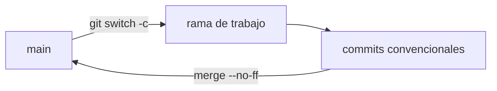

# Flujo de Git — AprovechaElBug

## 1. Modelo elegido: GitHub Flow

- `main` siempre contiene el estado estable y revisado del proyecto.
- Todo cambio nace en una rama corta, sale de `main` y vuelve a `main` mediante un merge.
- No hay ramas de larga vida (`develop`, `release`).

**Por qué GitHub Flow:** el trabajo es individual, los ciclos son cortos (días) y se busca
una historia fácil de leer. Git Flow agrega ramas de integración y de release que no
aportan nada con un solo desarrollador y un solo entorno.



## 2. Ramas

| Rama | Uso | Ejemplo |
|------|-----|---------|
| `main` | estado estable; solo recibe merges | — |
| `docs/<documento>` | un documento o grupo coherente (Instancia A) | `docs/prd` |
| `feat/<modulo>-<tarea>` | una tarea del Implementation Plan (Instancia B) | `feat/m1-login` |
| `fix/<descripcion>` | corrección de un defecto | `fix/paginacion-total` |
| `test/<descripcion>` | tests | `test/roadmap-service` |
| `docker/<descripcion>` | cambios de contenedores | `docker/backend-multistage` |
| `chore/<descripcion>` | configuración y mantenimiento | `chore/repo-setup` |

**Reglas de nombre:** minúsculas, palabras separadas por guiones, prefijo igual al tipo
de commit principal de la rama.

## 3. Ciclo de trabajo (1 rama = 1 documento o 1 tarea)

```bash
git switch main && git pull
git switch -c docs/<nombre>
# trabajar y commitear en pasos pequeños (ver §4)
git push -u origin docs/<nombre>
git switch main
git merge --no-ff docs/<nombre> -m "docs: merge docs/<nombre> branch"
git push origin main
```