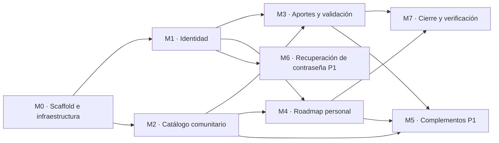

# Implementation Plan — AprovechaElBug

> **Qué es:** el orden de construcción de la Instancia B: módulos, dependencias, tareas con
> su definición de hecho y estimaciones. Las historias están en el [PRD](PRD.md), la API en
> el [BackendSchema](BackendSchema.md), las pantallas en el [APPFlow](APPFlow.md) y las
> decisiones técnicas en el [TRD](TRD.md).

## 1. MVP — qué es P0

> Criterio de MVP: en una máquina limpia, `git clone`, copiar `.env.example` a `.env`,
> `docker compose up` y recorrer end-to-end las siguientes historias del PRD, sin errores
> en la consola del navegador ni en los logs del backend:

- **US-001:** ver el catálogo paginado sin registrarse.
- **US-002:** registrarse con email y contraseña.
- **US-003:** iniciar y cerrar sesión, con bloqueo tras 5 intentos fallidos.
- **US-004:** aportar un curso (queda en revisión y no aparece en el catálogo).
- **US-005:** como moderador, aprobar y rechazar aportes.
- **US-006:** incluir un curso del catálogo en mi roadmap y verlo en "Mi roadmap".

Recorrido de verificación (se tilda al cerrar la Instancia B):

- [ ] `/catalogo` muestra 20 cursos y el paginador; la página 2 muestra el resto.
- [ ] Registro de un usuario nuevo y rechazo de un email repetido.
- [ ] Login correcto, login incorrecto con mensaje genérico, y el 6.º intento seguido muestra el bloqueo.
- [ ] Con ese usuario, `/aportar` crea un aporte; el mismo enlace una segunda vez da error de duplicado.
- [ ] El aporte no aparece en el catálogo.
- [ ] Con el moderador del seed, `/validar` lista el aporte; se aprueba uno y se rechaza otro con motivo.
- [ ] El aporte aprobado aparece en el catálogo; el rechazado no.
- [ ] El usuario agrega ese curso a su roadmap y lo ve en `/roadmap`.
- [ ] Un usuario sin rol moderador ve "No tenés permiso" en `/validar`.

Las historias P1 (US-007 a US-010) se construyen después, en este orden: US-009, US-007, US-010 y US-008.

## 2. Módulos y dependencias

Las flechas son dependencias reales: no se prueba el catálogo sin el scaffold, no se aporta sin sesión, y el roadmap necesita sesión y cursos publicados.

| Módulo | Historias | Prioridad | Esfuerzo estimado |
|--------|-----------|-----------|-------------------|
| M0 · Scaffold e infraestructura | — | P0 | 6 h |
| M1 · Identidad | US-002, US-003 | P0 | 9 h |
| M2 · Catálogo comunitario | US-001 | P0 | 8 h |
| M3 · Aportes y validación | US-004, US-005 | P0 | 9 h |
| M4 · Roadmap personal | US-006 | P0 | 5 h |
| M7 · Cierre y verificación | — | P0 | 2 h |
| M5 · Complementos del catálogo y roadmap | US-007, US-009, US-010 | P1 | 8 h |
| M6 · Recuperación de contraseña | US-008 | P1 | 4 h |