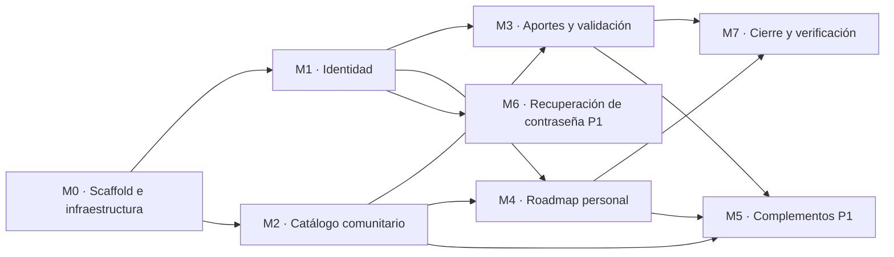

# Implementation Plan — AprovechaElBug

> **Qué es:** el orden de construcción de la Instancia B: módulos, dependencias, tareas con
> su definición de hecho y estimaciones. Las historias están en el [PRD](PRD.md), la API en
> el [BackendSchema](BackendSchema.md), las pantallas en el [APPFlow](APPFlow.md) y las
> decisiones técnicas en el [TRD](TRD.md).

## 1. MVP — qué es P0

> Criterio de MVP: en una máquina limpia, `git clone`, copiar `.env.example` a `.env`,
> `docker compose up` y recorrer end-to-end las siguientes historias del PRD, sin errores
> en la consola del navegador ni en los logs del backend:

- **US-001:** ver el catálogo paginado sin registrarse.
- **US-002:** registrarse con email y contraseña.
- **US-003:** iniciar y cerrar sesión, con bloqueo tras 5 intentos fallidos.
- **US-004:** aportar un curso (queda en revisión y no aparece en el catálogo).
- **US-005:** como moderador, aprobar y rechazar aportes.
- **US-006:** incluir un curso del catálogo en mi roadmap y verlo en "Mi roadmap".

Recorrido de verificación (se tilda al cerrar la Instancia B):

- [ ] `/catalogo` muestra 20 cursos y el paginador; la página 2 muestra el resto.
- [ ] Registro de un usuario nuevo y rechazo de un email repetido.
- [ ] Login correcto, login incorrecto con mensaje genérico, y el 6.º intento seguido muestra el bloqueo.
- [ ] Con ese usuario, `/aportar` crea un aporte; el mismo enlace una segunda vez da error de duplicado.
- [ ] El aporte no aparece en el catálogo.
- [ ] Con el moderador del seed, `/validar` lista el aporte; se aprueba uno y se rechaza otro con motivo.
- [ ] El aporte aprobado aparece en el catálogo; el rechazado no.
- [ ] El usuario agrega ese curso a su roadmap y lo ve en `/roadmap`.
- [ ] Un usuario sin rol moderador ve "No tenés permiso" en `/validar`.

Las historias P1 (US-007 a US-010) se construyen después, en este orden: US-009, US-007, US-010 y US-008.

## 2. Módulos y dependencias

Las flechas son dependencias reales: no se prueba el catálogo sin el scaffold, no se aporta sin sesión, y el roadmap necesita sesión y cursos publicados.

| Módulo | Historias | Prioridad | Esfuerzo estimado |
|--------|-----------|-----------|-------------------|
| M0 · Scaffold e infraestructura | — | P0 | 6 h |
| M1 · Identidad | US-002, US-003 | P0 | 9 h |
| M2 · Catálogo comunitario | US-001 | P0 | 8 h |
| M3 · Aportes y validación | US-004, US-005 | P0 | 9 h |
| M4 · Roadmap personal | US-006 | P0 | 5 h |
| M7 · Cierre y verificación | — | P0 | 2 h |
| M5 · Complementos del catálogo y roadmap | US-007, US-009, US-010 | P1 | 8 h |
| M6 · Recuperación de contraseña | US-008 | P1 | 4 h |

## 3. Detalle por módulo

> Los comandos de verificación asumen `docker compose up` corriendo. Los endpoints se
> prueban desde `http://localhost:8000/docs` (documentación OpenAPI de FastAPI) o con `curl`.

### M0 — Scaffold e infraestructura

| # | Tarea | Hecho cuando… | Estimación |
|---|-------|----------------|------------|
| 0.1 | Estructura de carpetas del TRD §3.2 (con archivos `.gitkeep` donde falte contenido) | el árbol del repo coincide con el TRD §3.2 | 20 min |
| 0.2 | `docker-compose.yml` con PostgreSQL 18.6, volumen, healthcheck y `.env.example` | `docker compose up postgres` queda `healthy` y `docker compose exec postgres psql -U <usuario> -d <base> -c "select 1"` responde | 30 min |
| 0.3 | Backend FastAPI mínimo, su Dockerfile y servicio en Compose | `http://localhost:8000/docs` abre la documentación OpenAPI | 45 min |
| 0.4 | Conexión a la base (SQLAlchemy) y Alembic configurado | `docker compose exec backend alembic upgrade head` termina sin error y existe la tabla `alembic_version` | 45 min |
| 0.5 | Errores y paginación compartidos (`errores.py`, `paginacion.py`) con el formato del TRD §4 | `curl http://localhost:8000/api/v1/inexistente` responde 404 con `{"error": {"code": "NOT_FOUND", ...}}` | 45 min |
| 0.6 | Frontend Vite + React 19: router con las 12 rutas del APPFlow (pantallas vacías), tokens CSS de UX-UI §2.4 y proxy de `/api` con `xfwd` | `pnpm dev` muestra cada ruta del APPFlow con su título y la ruta desconocida muestra "Página no encontrada" | 1 h |
| 0.7 | Header y menú sándwich (UX-UI §4.8) | en 360 px el botón abre y cierra el panel con clic, X, `ESC` y overlay; desde 1024 px la navegación es horizontal y el botón se oculta | 1 h 15 min |
| 0.8 | Dockerfile del frontend y servicio en Compose | `docker compose up` levanta los tres servicios y `http://localhost:5173/api/v1/inexistente` llega al backend (404 con el envelope) | 30 min |

### M1 — Identidad

| # | Tarea | Hecho cuando… | Estimación |
|---|-------|----------------|------------|
| 1.1 | Migración y modelo `usuarios` (enum `rol_usuario`, índice único sobre `lower(email)`) | `alembic upgrade head` crea la tabla y `\d usuarios` en `psql` muestra constraints e índice del BackendSchema §1.2 | 30 min |
| 1.2 | Service de contraseñas: hash y verificación con bcrypt (costo 12) y validación de 8 a 72 caracteres | una función pura devuelve un hash distinto de la contraseña; verificar acierta con la correcta y falla con otra; 7 y 73 caracteres se rechazan | 20 min |
| 1.3 | `POST /auth/registro` | desde `/docs`: 201 con usuario nuevo; mismo email con otras mayúsculas 409; contraseña corta 422; todos con el envelope de errores | 1 h |
| 1.4 | Rate limiter en memoria (TD-005) como función pura con reloj inyectable | tras 5 fallos en 15 minutos la función indica bloqueo y los segundos restantes; con el reloj adelantado se desbloquea; un éxito reinicia el contador | 45 min |
| 1.5 | `POST /auth/login` con cookie JWT HttpOnly (TD-001) y respuesta 429 | credenciales correctas: 200 y cookie `aeb_session` HttpOnly; incorrectas: 401 con mensaje genérico; el 6.º fallo seguido: 429 con `Retry-After` y `retry_after_seconds` | 1 h |
| 1.6 | `GET /auth/me`, `POST /auth/logout` y dependencias de sesión y de rol | `me` devuelve el usuario con cookie y `null` sin ella; `logout` borra la cookie y una ruta protegida pasa a responder 401; la dependencia de rol responde 403 a un usuario sin rol | 45 min |
| 1.7 | Seed del moderador (TD-007, parte 1): script idempotente con credenciales de variables de entorno | tras `docker compose up` existe un usuario con rol `moderador` y correr el seed dos veces no lo duplica | 30 min |
| 1.8 | Frontend: cliente HTTP compartido (cookies, envelope de errores, manejo global del 401), contexto de sesión con `GET /auth/me` y header con estado de sesión | sin sesión el header muestra "Ingresar" y "Registrarme"; con sesión muestra el nombre y "Cerrar sesión" | 1 h |
| 1.9 | Pantallas Registro y Login, redirección con `?volver=` y rutas protegidas (APPFlow §3 y §5) | **US-002 y US-003 desde la UI:** registro, error de email repetido, login, mensaje genérico ante credenciales malas, bloqueo con el tiempo de espera, cierre de sesión, y `/roadmap` sin sesión redirige a `/login?volver=/roadmap` | 2 h |

### M2 — Catálogo comunitario

| # | Tarea | Hecho cuando… | Estimación |
|---|-------|----------------|------------|
| 2.1 | Migración y modelos `categorias` y `cursos` (enums, constraints de coherencia e índices parciales) | `\d cursos` muestra constraints e índices del BackendSchema §1.2 | 45 min |
| 2.2 | Seed de categorías y cursos de prueba (TD-007, parte 2) | al levantar hay categorías y al menos 25 cursos publicados de varias plataformas, además de algunos `en_revision` y uno `rechazado`; una opción del seed genera 1.000 cursos para medir RNF-007 | 1 h |
| 2.3 | `GET /categorias` | responde la lista completa ordenada por nombre | 20 min |
| 2.4 | `GET /cursos` paginado (solo publicados, más recientes primero) | `page_size=20` devuelve 20 ítems y el `total` correcto; ningún curso `en_revision` ni `rechazado` aparece; `page_size=51` responde 422 | 1 h |
| 2.5 | `GET /cursos/{id}` | 200 para un publicado; 404 para uno en revisión, uno rechazado y uno inexistente | 20 min |
| 2.6 | Componentes compartidos del frontend: botón, paginador, skeleton, estado vacío y toast (UX-UI §4) | existen con los estados definidos en UX-UI y muestran el anillo de foco con teclado | 1 h 30 min |
| 2.7 | Pantalla Catálogo: grid, paginador y estados | **US-001:** `/catalogo` muestra 20 cards y el paginador; cambiar de página actualiza `?page=`; 1 columna en 360 px, 2 desde 768 px y 3 desde 1024 px; se ven los estados de carga, vacío y error | 2 h |
| 2.8 | Pantalla Detalle de curso | `/catalogo/:id` muestra todos los datos y el enlace externo en otra pestaña; un id inexistente muestra "Curso no encontrado" | 1 h |

### M3 — Aportes y validación

| # | Tarea | Hecho cuando… | Estimación |
|---|-------|----------------|------------|
| 3.1 | Normalización de enlaces como función pura (BR-004) | `https://Ejemplo.com/Curso/?utm_source=a&id=3#x` produce `https://ejemplo.com/Curso?id=3`, y al menos 5 casos más se resuelven según BR-004 | 30 min |
| 3.2 | `POST /aportes` | con sesión crea un curso `en_revision` (201); el mismo enlace con otra forma da 409; sin `lo_tomo_aportante` da 422; sin sesión 401; el curso no aparece en `GET /cursos` | 1 h 30 min |
| 3.3 | `GET /aportes/pendientes` | el moderador ve los aportes en revisión paginados, los más antiguos primero; un usuario común recibe 403 | 45 min |
| 3.4 | `POST /aportes/{id}/validar` | aprobar deja el curso `publicado` y aparece en `GET /cursos`; rechazar sin motivo da 422; con motivo queda `rechazado`; decidir dos veces da 409; un usuario común recibe 403 | 1 h |
| 3.5 | Pantalla Aportar curso (UX-UI §4.3) | **US-004:** el formulario valida en línea y no pierde lo escrito; un enlace repetido marca el campo con el error; el envío correcto muestra el toast y redirige a `/mis-aportes` | 2 h 30 min |
| 3.6 | Pantalla Validación (lista, aprobar, modal de rechazo con motivo obligatorio) | **US-005:** el moderador ve los pendientes, aprueba (el curso aparece en el catálogo) y rechaza con motivo; un usuario común ve "No tenés permiso"; la opción "Validar" solo aparece en el menú del moderador | 2 h 30 min |

> Hasta completar las tareas 5.2 y 5.3, `/mis-aportes` muestra una pantalla provisoria
> ("Próximamente"); el toast de la tarea 3.5 confirma el envío.

### M4 — Roadmap personal

| # | Tarea | Hecho cuando… | Estimación |
|---|-------|----------------|------------|
| 4.1 | Migración y modelo `roadmap_items` (`UNIQUE (usuario_id, curso_id)`, índice por usuario y orden) | `\d roadmap_items` coincide con el BackendSchema §1.2 | 30 min |
| 4.2 | `POST /roadmap/items` | curso publicado: 201 con la posición al final; repetido: 409; en revisión o inexistente: 404; sin sesión: 401 | 1 h |
| 4.3 | `GET /roadmap` | devuelve solo los ítems del usuario de la sesión, paginados y ordenados, cada uno con su curso; otro usuario no ve ítems ajenos | 45 min |
| 4.4 | Campo `en_mi_roadmap` en `GET /cursos` y `GET /cursos/{id}` | con sesión devuelve `true` para los cursos ya incluidos; sin sesión, siempre `false` | 30 min |
| 4.5 | Botón "Agregar a mi roadmap" en cards y detalle (con redirección a login si no hay sesión) | Flujo 2 del APPFlow, pasos 4 a 7: sin sesión va a `/login?volver=…`; con sesión muestra el toast y la card pasa a "En tu roadmap" | 1 h |
| 4.6 | Pantalla Mi roadmap | **US-006:** el curso agregado aparece en `/roadmap`; sin cursos se ve el estado vacío con acceso al catálogo; en 360 px se ve como cards y desde 768 px como tabla | 1 h 30 min |

### M5 — Complementos del catálogo y del roadmap (P1)

| # | Tarea | Hecho cuando… | Estimación |
|---|-------|----------------|------------|
| 5.1 | **US-007:** filtros `q` y `categoria` en `GET /cursos` y búsqueda y filtro en la pantalla Catálogo, con el estado en la URL | el texto filtra por título o tema; la categoría filtra por categoría; combinados aplican ambos y el `total` del paginador refleja el filtrado; sin resultados se ve el estado vacío con "Limpiar filtros" | 2 h |
| 5.2 | `GET /aportes/mios` | devuelve solo los aportes del usuario, paginados, con `estado` y `motivo_rechazo` | 45 min |
| 5.3 | **US-009:** pantalla Mis aportes con badges de estado (UX-UI §4.5) | se ven los aportes con su estado e icono; un aporte rechazado muestra su motivo; sin aportes aparece el estado vacío | 1 h 30 min |
| 5.4 | `PATCH /roadmap/items/{id}` y `POST /roadmap/items/{id}/mover` | cambiar `estado_avance` responde 200; subir y bajar intercambia posiciones con el vecino y en el extremo no cambia nada; un ítem ajeno da 404 | 1 h 30 min |
| 5.5 | `DELETE /roadmap/items/{id}` | 204 y el ítem desaparece de `GET /roadmap`; un ítem ajeno da 404 | 30 min |
| 5.6 | **US-010:** controles del roadmap (select de avance, Subir y Bajar, Quitar con modal) | los cambios se mantienen al recargar; quitar pide confirmación; todo se opera con teclado | 2 h |

### M6 — Recuperación de contraseña (P1)

| # | Tarea | Hecho cuando… | Estimación |
|---|-------|----------------|------------|
| 6.1 | Migración y modelo `password_reset_tokens` | `\d password_reset_tokens` coincide con el BackendSchema §1.2 | 20 min |
| 6.2 | `POST /auth/recuperar` (respuesta 202 uniforme, token con hash, enlace en el log) | un email existente y uno inexistente devuelven exactamente la misma respuesta; para el existente aparece el enlace en `docker compose logs backend` | 1 h |
| 6.3 | `POST /auth/restablecer` | con un token válido cambia la contraseña y el login funciona con la nueva; el mismo token usado otra vez da 422; un token vencido da 422 | 1 h |
| 6.4 | **US-008:** pantallas Olvidé mi contraseña y Restablecer | el flujo 5 del APPFlow se completa desde la UI, incluido el mensaje de token inválido con enlace para pedir otro | 1 h 30 min |

### M7 — Cierre y verificación (P0)

| # | Tarea | Hecho cuando… | Estimación |
|---|-------|----------------|------------|
| 7.1 | README con instrucciones de ejecución verificables | incluye requisitos (Docker y Docker Compose), `cp .env.example .env`, `docker compose up`, las URLs (frontend `:5173`, documentación de la API `:8000/docs`), las credenciales del moderador de prueba y cómo reiniciar la base | 30 min |
| 7.2 | Verificación en máquina limpia | un clon nuevo del repo, siguiendo solo el README, completa el recorrido del §1 sin errores en consola ni en los logs | 1 h |
| 7.3 | Actualizar la tabla de ejecución (§4) | todas las tareas terminadas están en `[x]` con su rama y commit | 20 min |

## 4. Ejecución (Instancia B)

> **Regla:** 1 tarea (o lote coherente) = una rama `feat/T{N}-descripcion-corta` que nace de `dev`
> según el [flujo de Git](GIT_WORKFLOW.md), más sus commits convencionales. Esta tabla se actualiza mientras se avanza.

| # | Tarea | Módulo | Estado | Rama / Commit |
|---|-------|--------|--------|---------------|
| 0.1 | Estructura de carpetas | M0 | [ ] | |
| 0.2 | docker-compose con PostgreSQL | M0 | [ ] | |
| 0.3 | Backend FastAPI mínimo | M0 | [ ] | |
| 0.4 | SQLAlchemy y Alembic | M0 | [ ] | |
| 0.5 | Errores y paginación compartidos | M0 | [ ] | |
| 0.6 | Frontend Vite con rutas y tokens | M0 | [ ] | |
| 0.7 | Header y menú sándwich | M0 | [ ] | |
| 0.8 | Dockerfile del frontend y Compose completo | M0 | [ ] | |
| 1.1 | Migración y modelo `usuarios` | M1 | [ ] | |
| 1.2 | Service de contraseñas | M1 | [ ] | |
| 1.3 | `POST /auth/registro` | M1 | [ ] | |
| 1.4 | Rate limiter en memoria | M1 | [ ] | |
| 1.5 | `POST /auth/login` | M1 | [ ] | |
| 1.6 | `GET /auth/me`, logout y dependencias | M1 | [ ] | |
| 1.7 | Seed del moderador | M1 | [ ] | |
| 1.8 | Cliente HTTP, sesión y header | M1 | [ ] | |
| 1.9 | Pantallas Registro y Login | M1 | [ ] | |
| 2.1 | Migración `categorias` y `cursos` | M2 | [ ] | |
| 2.2 | Seed de categorías y cursos | M2 | [ ] | |
| 2.3 | `GET /categorias` | M2 | [ ] | |
| 2.4 | `GET /cursos` | M2 | [ ] | |
| 2.5 | `GET /cursos/{id}` | M2 | [ ] | |
| 2.6 | Componentes compartidos | M2 | [ ] | |
| 2.7 | Pantalla Catálogo | M2 | [ ] | |
| 2.8 | Pantalla Detalle | M2 | [ ] | |
| 3.1 | Normalización de enlaces | M3 | [ ] | |
| 3.2 | `POST /aportes` | M3 | [ ] | |
| 3.3 | `GET /aportes/pendientes` | M3 | [ ] | |
| 3.4 | `POST /aportes/{id}/validar` | M3 | [ ] | |
| 3.5 | Pantalla Aportar curso | M3 | [ ] | |
| 3.6 | Pantalla Validación | M3 | [ ] | |
| 4.1 | Migración `roadmap_items` | M4 | [ ] | |
| 4.2 | `POST /roadmap/items` | M4 | [ ] | |
| 4.3 | `GET /roadmap` | M4 | [ ] | |
| 4.4 | `en_mi_roadmap` en cursos | M4 | [ ] | |
| 4.5 | Botón "Agregar a mi roadmap" | M4 | [ ] | |
| 4.6 | Pantalla Mi roadmap | M4 | [ ] | |
| 7.1 | README de ejecución | M7 | [ ] | |
| 7.2 | Verificación en máquina limpia | M7 | [ ] | |
| 7.3 | Actualizar esta tabla | M7 | [ ] | |
| 5.1 | Búsqueda y filtros (P1) | M5 | [ ] | |
| 5.2 | `GET /aportes/mios` (P1) | M5 | [ ] | |
| 5.3 | Pantalla Mis aportes (P1) | M5 | [ ] | |
| 5.4 | `PATCH` y `mover` del roadmap (P1) | M5 | [ ] | |
| 5.5 | `DELETE` del roadmap (P1) | M5 | [ ] | |
| 5.6 | Controles del roadmap (P1) | M5 | [ ] | |
| 6.1 | Migración `password_reset_tokens` (P1) | M6 | [ ] | |
| 6.2 | `POST /auth/recuperar` (P1) | M6 | [ ] | |
| 6.3 | `POST /auth/restablecer` (P1) | M6 | [ ] | |
| 6.4 | Pantallas de recuperación (P1) | M6 | [ ] | |

## 5. Estrategia de testing

> Se **planifica** acá y se **implementa** en la clase del 27/10.

- **Unit tests (services), patrón AAA, sin base de datos ni HTTP:** hash y validación de contraseñas (1.2), rate limiter con reloj inyectado (1.4), normalización de enlaces (3.1), transiciones de estado del curso y exigencia de motivo al rechazar (3.4), reglas del roadmap (BR-006 y BR-007).
- **Integration tests (repositories y routers):** contra el PostgreSQL del Compose, con una base de pruebas aparte: unicidad de email y de enlace, paginación con `total`, filtros de estado en el catálogo, aislamiento del roadmap entre usuarios y permisos por rol.
- **Frontend:** hooks y componentes con Vitest y Testing Library: estados de carga, vacío y error del catálogo, paginador, formulario de aporte con validación en línea.
- **Objetivo de cobertura:** al menos 85 % en los services del backend.

## 6. Riesgos del plan

| Riesgo | Impacto | Mitigación |
|--------|---------|------------|
| El esfuerzo P0 (unas 39 h) es alto para la ventana entre la aprobación y el lunes a las 22:00 | alto | empezar en cuanto llegue el correo APROBADO; avanzar por tajadas verticales que dejen algo verificable cada pocas horas; apoyarse en asistencia para el código repetitivo; M5 y M6 solo si M7 está cerrado |
| La verificación en máquina limpia se deja para el final y aparece un fallo de entorno | alto | correr `docker compose up` completo desde un clon limpio al terminar M0 y de nuevo al terminar M2; reservar al menos 2 h antes del límite para M7 |
| Migraciones de Alembic y cambios de modelo bloquean varias tareas | medio | una migración por módulo; no editar migraciones ya aplicadas, crear una nueva |
| El rate limiting pierde sentido por la IP del contenedor | medio | verificar en 1.5 que el backend recibe `X-Forwarded-For` desde el proxy de Vite (TRD §6) |
| El formulario de aporte (11 campos) y su validación llevan más de lo estimado | medio | un schema de validación único por campo en el backend; en el frontend reglas simples que repliquen las del BackendSchema §3.3 |
| El punto de montaje del volumen de PostgreSQL 18 es distinto al de versiones anteriores | bajo | consultar la documentación de la imagen en 0.2 y probar `docker compose down` y `up` conservando los datos |

---

**Referencias:**
- Atlassian — Plantilla de plan de proyecto: https://www.atlassian.com/software/confluence/templates/project-plan
- Shape Up — cómo partir trabajo real en scopes cerrables: https://basecamp.com/shapeup/