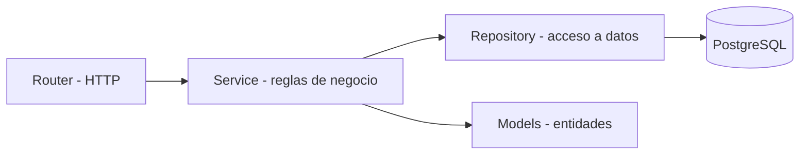
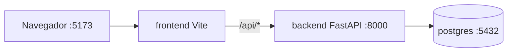

# TRD — Technical Requirements Document — AprovechaElBug

> **Qué es:** el CÓMO técnico de AprovechaElBug: stack, decisiones de arquitectura,
> estructura de carpetas y convenciones. El producto está en el [PRD](PRD.md); el orden de
> construcción, en el [Implementation Plan](IMPLEMENTATION_PLAN.md).

## 1. Stack y versiones exactas

Versiones verificadas el 23/10/2026 (ver [SPEC §6](SPEC.md)).

| Capa | Elección | Versión exacta | Por qué |
|------|----------|----------------|---------|
| Frontend | React + Vite + pnpm sobre Node | react 19.3.1 · vite 8.3.5 · pnpm 12.4.1 · node 22.17.1 | fijado por la SPEC; Vite da un servidor de desarrollo rápido y un proxy simple hacia la API |
| Backend | FastAPI + uv sobre Python | fastapi 0.161.1 · uv 0.13.5 · python 3.13.5 | fijado por la SPEC; validación y documentación OpenAPI automáticas |
| Validación | Pydantic (dependencia de FastAPI) | pydantic 2.14.1 | contratos de entrada y salida tipados |
| ORM / driver | SQLAlchemy 2 + psycopg 3 + Alembic | se fija en `uv.lock` al instalar (Instancia B) | modelo explícito, migraciones versionadas y repositorios simples |
| Seguridad | bcrypt (paquete `bcrypt`) y PyJWT | se fija en `uv.lock` al instalar | bcrypt exigido por la SPEC; JWT para la sesión (TD-001) |
| BD | PostgreSQL | 18.6 | fijado por la SPEC |
| Infra (dev) | Docker + Docker Compose | docker 29.9.2 · compose 5.6.1 | fijado por la SPEC |

> Los lockfiles (`uv.lock`, `pnpm-lock.yaml`) se versionan en la Instancia B y pasan a ser
> la fuente exacta de versiones de las librerías de aplicación.

## 2. Decisiones técnicas

| # | Decisión | Alternativas consideradas | Elegida | Por qué |
|---|----------|---------------------------|---------|---------|
| TD-001 | Autenticación y sesión | JWT en header `Authorization` guardado en `localStorage` · sesión en servidor · JWT en cookie HttpOnly | JWT (HS256) en cookie HttpOnly `SameSite=Lax`, expira a los 60 min, sin refresh. El token lleva `sub` y `rol` | La cookie HttpOnly no es legible desde JavaScript (mitiga robo por XSS). Como el frontend consume la API por el mismo origen (proxy de Vite), no hace falta CORS con credenciales. Sin refresh simplifica el MVP |
| TD-002 | Paginación | offset + total · cursor | offset + total: `page` (desde 1) y `page_size` (20 por defecto, máximo 50) | El paginador estilo Google necesita ir a una página concreta y conocer el total; los volúmenes del MVP no justifican cursores |
| TD-003 | Formato de errores de la API | envelope propio · RFC 7807 (`problem+json`) | Envelope propio `{ "error": { "code", "message", "details" } }` | Más simple de consumir desde el frontend y de testear; el `code` estable permite traducir mensajes sin depender del texto |
| TD-004 | Cómo modelar "mi roadmap" | tabla intermedia usuario-curso con orden y estado · lista dentro del usuario · tabla `roadmaps` con ítems (varios roadmaps por usuario) | Tabla `roadmap_items` (usuario, curso, orden, estado de avance) con restricción única por usuario y curso | Cubre BR-003 y BR-007 con una restricción de base de datos; un roadmap por usuario alcanza para el MVP |
| TD-005 | Rate limiting del login (BR-009) | `slowapi` · tabla en PostgreSQL · Redis · implementación propia en memoria | Implementación propia en memoria: contador de fallos por clave `IP + email` en ventana deslizante de 15 min, máximo 5; responde 429 con `Retry-After` | Un solo proceso en desarrollo, sin servicios nuevos, y la lógica queda como función pura con reloj inyectable, testeable el 27/10. Se pierde al reiniciar el backend (riesgo aceptado, ver §6) |
| TD-006 | Recuperación de contraseña (BR-008) | SMTP real · MailHog · registro en el log | Token aleatorio (`secrets.token_urlsafe(32)`); se guarda solo su hash SHA-256 con vencimiento a 1 h y marca de uso. El enlace de restablecimiento se escribe en el log del backend | Sin servidor de correo en desarrollo. Guardar solo el hash evita que una filtración de la base entregue tokens usables |
| TD-007 | Datos iniciales | cargar a mano · migración de datos · script de seed | Script `seed` idempotente que crea categorías, el moderador (credenciales desde variables de entorno) y cursos de prueba para el catálogo | Reproducible en una máquina limpia (RNF-009) y permite medir RNF-007 con datos |


## 3. Arquitectura

### 3.1 Patrón y capas

Screaming Architecture + arquitectura en capas:



- **Router:** recibe HTTP, valida con los schemas, delega al service y traduce el resultado. Sin lógica de negocio.
- **Service:** reglas de negocio (BR-001 a BR-011). Funciones testeables sin base de datos ni HTTP; el reloj y el generador de tokens se inyectan.
- **Repository:** única puerta a la base de datos. Sin reglas de negocio.
- **La estructura de carpetas habla del dominio**, no del framework: `identidad`, `categorias`, `cursos`, `aportes`, `roadmap`.

### 3.2 Estructura de carpetas (la que se crea en la Instancia B)

```text
roadmap-cursos/
├── backend/
│   ├── pyproject.toml
│   ├── uv.lock
│   ├── Dockerfile
│   ├── alembic.ini
│   ├── migrations/
│   ├── app/
│   │   ├── main.py                 # app FastAPI, routers y handlers de errores
│   │   ├── config.py               # variables de entorno
│   │   ├── database.py             # engine y sesión
│   │   ├── errores.py              # envelope de errores (TD-003)
│   │   ├── paginacion.py           # parámetros y respuesta paginada (TD-002)
│   │   ├── seed.py                 # datos iniciales (TD-007)
│   │   ├── identidad/              # registro, login, sesión, recuperación, rate limit
│   │   │   ├── router.py
│   │   │   ├── service.py
│   │   │   ├── repository.py
│   │   │   ├── models.py
│   │   │   └── schemas.py
│   │   ├── categorias/             # lista cerrada de categorías
│   │   ├── cursos/                 # catálogo comunitario (solo publicados)
│   │   ├── aportes/                # aportar, mis aportes y validación del moderador
│   │   └── roadmap/                # roadmap personal
│   └── tests/
├── frontend/
│   ├── package.json
│   ├── pnpm-lock.yaml
│   ├── vite.config.js              # incluye el proxy de /api
│   ├── Dockerfile
│   └── src/
│       ├── main.jsx
│       ├── app/                    # shell, router, header con menú sándwich
│       ├── features/
│       │   ├── identidad/          # registro, login, recuperación
│       │   ├── catalogo/           # listado, detalle, búsqueda y filtros
│       │   ├── aportes/            # formulario, mis aportes, panel de validación
│       │   └── roadmap/            # mi roadmap
│       │       ├── components/
│       │       ├── hooks/
│       │       └── api.js
│       ├── compartido/             # paginador, botones, cliente HTTP, toasts
│       └── styles/                 # tokens globales (UX-UI)
├── docker-compose.yml
├── .env.example
└── docs/
```

Los módulos `categorias`, `cursos`, `aportes` y `roadmap` repiten la estructura de `identidad` (router, service, repository, models, schemas). `aportes` y `cursos` comparten la entidad `Curso`, definida en `cursos/models.py`.

### 3.3 Servicios Docker (entorno de desarrollo)

| Servicio | Imagen / base | Puerto | Rol |
|----------|---------------|--------|-----|
| postgres | postgres:18.6 | 5432 | base de datos, con volumen y healthcheck |
| backend | python:3.13-slim + uv | 8000 | API FastAPI (modo desarrollo) |
| frontend | node:22-alpine + pnpm | 5173 | SPA Vite (servidor de desarrollo) |



- El navegador solo habla con el frontend; Vite reenvía `/api/*` al backend (proxy con `xfwd` para conservar la IP del cliente, necesaria para el rate limiting).
- El backend arranca después de que PostgreSQL pasa su healthcheck, ejecuta las migraciones y el seed, y recién entonces levanta la API.
- El volumen de PostgreSQL se monta según indica la documentación de la imagen 18 (verificar el punto de montaje al escribir el `docker-compose.yml`).

> En la clase del 27/10 los Dockerfiles evolucionan a multi-stage. Por ahora, lo mínimo que levanta.